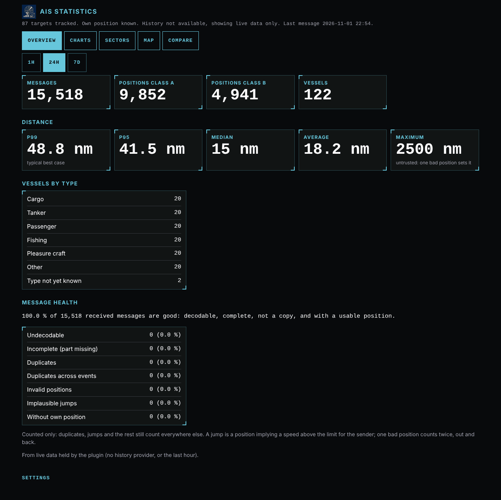
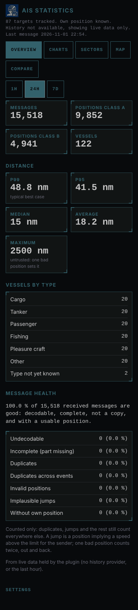
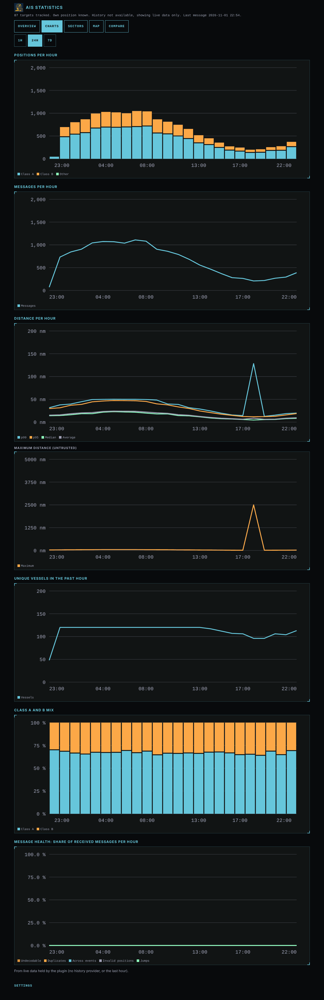
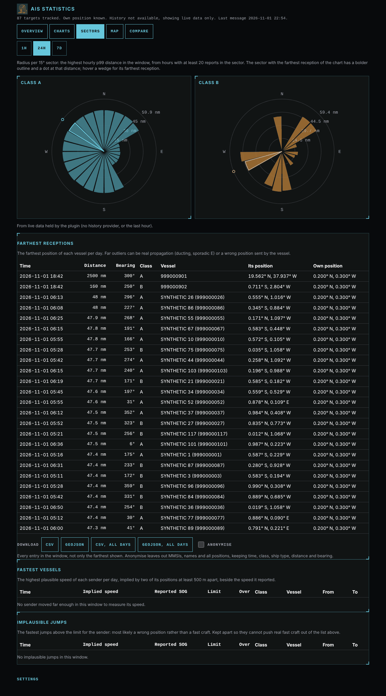
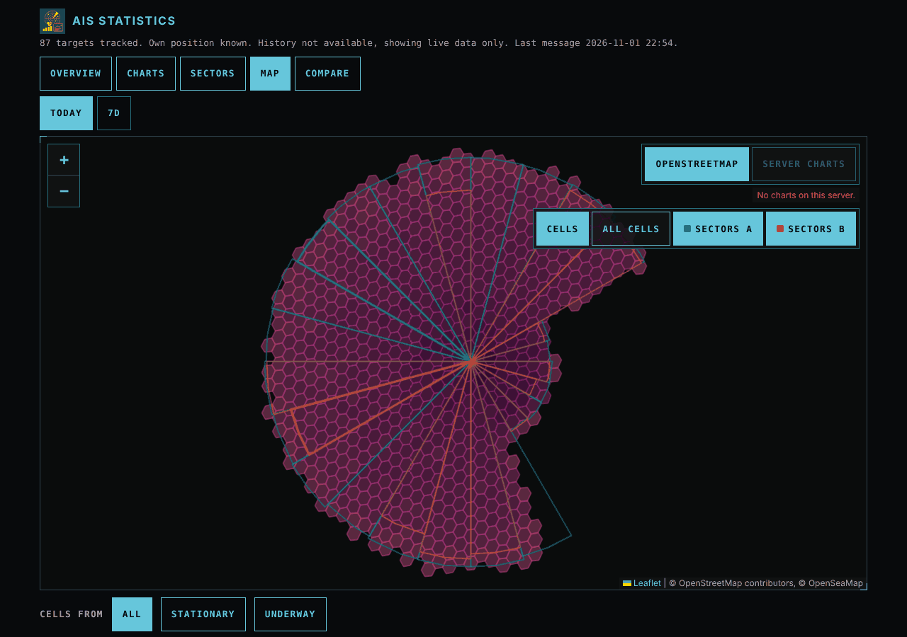

# signalk-ais-statistics

A SignalK server plugin that turns the AIS traffic your server already
receives into reception statistics for your own AIS station: how many
vessels you hear, how far your receiver reaches in each direction, which
areas you have heard traffic from, and how healthy the message stream is.
Everything is computed on the boat and works offline.



**Status:** working toward 1.0.0. The plugin, its web app and the plotter
overlay run on real boats. Paths, the REST API, the overlay and the export
formats may still change before user feedback settles them; changes are
listed in the [CHANGELOG](CHANGELOG.md).

## Contents

- [What it does](#what-it-does)
- [Requirements](#requirements)
- [Install](#install)
- [The web app](#the-web-app)
- [Live settings](#live-settings)
- [Configuration](#configuration)
- [History provider setup](#history-provider-setup)
- [Chart plotter overlay](#chart-plotter-overlay)
- [Troubleshooting](#troubleshooting)
- [Published paths and API](#published-paths-and-api)
- [Development](#development)

## What it does

- **Counts** vessels (by type group and class A or B), positions and
  messages per minute and hour.
- **Range**: average, median, p95, p99 and maximum reception distance, and
  24 bearing sectors per class. Percentiles keep the figures meaningful
  when a bad position arrives; the maximum is shown but marked untrusted.
- **Far receptions**: the sector with the farthest reception is outlined
  bolder and carries a dot at that distance, and a daily log lists the
  farthest receptions with time, vessel, and both positions, so a ducting
  or sporadic E opening can be told from a wrong position.
- **Coverage**: which areas you have actually heard traffic from, per day,
  for a moving boat, kept apart for stationary and underway.
- **Message health**: undecodable, incomplete and duplicate messages,
  invalid positions, implausible position jumps and the class A/B mix.
  Nothing is dropped; these only count.
- **Propagation alerts** (off by default): a SignalK notification while
  your range is well above normal.
- **Range vs weather**: hourly range against pressure, temperatures or
  humidity from your own sensors, with a scatter and its correlation.
- **Compare** two date windows side by side, such as before and after an
  antenna change, and optionally each input source on its own.
- **Downloads**: coverage cells (H3 ids) and farthest receptions as CSV or
  GeoJSON, with an anonymise switch for sharing.
- **Published paths** under `sensors.ais.statistics.*`, so any history
  provider records them.
- **Plotter overlay**: the coverage footprint and the sectors as a layer
  in Freeboard-SK 3.4.0 or later.

## Requirements

- A SignalK server (developed against 2.35) with AIS arriving from an NMEA
  0183 or NMEA 2000 receiver. NMEA 2000 needs no converter plugin.
- The own vessel's position (`navigation.position`). Without it the plugin
  still counts messages and vessels, but not distances, sectors or
  coverage.
- Recommended: a History API provider such as `signalk-questdb`, for
  windows longer than the plugin has been running and for range vs weather.
- Optional: `@meri-imperiumi/signalk-internet` tells the map when the
  connection is metered, and Freeboard-SK 3.4.0 or later shows the overlay.

## Install

1. In the SignalK admin UI, open **App Store**, search for **AIS
   Statistics** and install it. Restart the server when asked.
2. Open **Server, Plugin Config, AIS Statistics**, enable it and save. The
   defaults suit most boats; see [Configuration](#configuration).
3. Open the web app from **Webapps, AIS Statistics**, or at
   `/signalk-ais-statistics/` on your server.

The first figures appear within a minute of AIS traffic. Read-only users
can open the web app; only readwrite and admin users can save settings
from it.

## The web app

Every page has a window selector (1 hour, 24 hours, 7 days), works on a
phone, and follows the server's day and night mode. A collapsed Settings
panel at the foot of every page lists the settings in effect.

**Overview**: messages, positions by class, vessels, the distance figures
and vessels by type, plus message health with a hint when one receiver
seems to reach two configured events.



**Charts**: positions and messages per hour by class, distance average,
p95 and p99 per hour, the class mix and the health shares. With a history
provider, a range vs weather section plots the hourly p99 range against
one of your weather paths.



**Sectors**: the 24 bearing sectors for class A and B. The sector with the
farthest reception is outlined bolder and has a dot at that distance. Below
it, the farthest receptions of the window, the fastest vessels and the
implausible jumps, and the downloads. With propagation alerts on, a card at
the top shows the alert state.



**Map**: the coverage cells and the 24 hour sectors on OpenStreetMap with
OpenSeaMap, or on the server's own charts when offline or on a metered
connection. Toggles show or hide the cells, the sparse cells beyond the
distance cap and each class's sectors. Under the map you pick the cells of
all modes, stationary or underway, try the distance cap, and download the
cells.



**Compare**: two date windows of 1 to 7 days side by side, with the change
in each figure and both sector charts on one scale.

## Live settings

A few settings are easiest to judge while watching their effect, so the
web app has controls for them. Moving a control changes the view at once;
**Save** stores the value in the plugin config, and **Reset** goes back to
the saved one. Save shows only to readwrite and admin users, or to everyone
while the server's security is off.

| Setting | Where |
|---|---|
| Coverage distance cap | slider under the map |
| Propagation alert factor, vessels and duration | sliders on the sectors page, with alerts on |

Everything else is set in the server's plugin config form.

## Configuration

All options are in **Server, Plugin Config, AIS Statistics**, in this
order. The defaults are meant to fit a typical cruising boat.

| Option | Default | What it does |
|---|---|---|
| **AIS input** | | |
| `sentenceEvents` | `nmea0183`, `N2KAnalyzerOut` | Server events to read AIS from: NMEA 0183 sentences and NMEA 2000 PGNs as the server decodes them. Events with raw sentences from converter plugins, such as `nmea0183AISout`, work too. List each receiver once, or its messages count twice |
| `sourceStatistics` | off | Also count each event on its own, to compare two receivers or antennas. About doubles the history stored with two events |
| `ownPositionMaxAgeSeconds` | 60 | An older own position counts as unknown, so distances are not taken from it |
| `targetExpirySeconds` | 3600 | A vessel silent for this long is no longer tracked |
| **Publishing** | | |
| `publishIntervalMinutes` | 5 | How often the paths are published to the server and its history provider; a divisor of 60. Sector paths go out hourly |
| `publishOverlay` | on | Offer the coverage overlay to chart plotters |
| **Coverage** | | |
| `h3Resolution` | 6 | Size of the coverage cells: 6 is about 7 km across, 5 about 20 km, 7 about 3 km |
| `coverageDistancePercentile` | 99 | Leave out cells with fewer than 3 reports beyond this percentile of the window's distances; 100 turns the cap off. Live setting |
| `coverageRetentionDays` | 14 | How long the daily coverage and farthest reception files are kept; also how far back downloads reach |
| **Stationary or underway** | | |
| `modeDriftRadiusMeters` | 200 | Without a `navigation.state`, the boat is stationary while its position stays within this distance |
| `modeDriftMinutes` | 10 | for this long |
| **Message health** | | |
| `jumpSpeedLimitKnots` | 60 | A position implying a faster speed counts as an implausible jump |
| `jumpSpeedLimitHighSpeedKnots` | 120 | The same for high-speed craft and wing in ground craft |
| `jumpSpeedLimitAircraftKnots` | 600 | The same for SAR aircraft |
| **Range vs weather** | | |
| `weatherPaths` | outside pressure, temperature and humidity, water temperature | Up to 8 numeric paths of your vessel to chart against range. An empty list hides the section |
| **Propagation alerts** | | |
| `propagationAlerts` | off | Raise a notification while the range is well above normal |
| `propagationFactor` | 2 | Recent p99 range over the normal p99 (the 7 day median). Live setting |
| `propagationMinVessels` | 3 | Vessels received beyond the normal range. Live setting |
| `propagationSustainMinutes` | 15 | How long both must hold to raise the alert, and fail to clear it. Live setting |
| `propagationWindowMinutes` | 15 | The recent window the check looks at |
| `propagationNotificationState` | `warn` | `alert`, `warn`, `alarm` or `emergency` |
| `propagationNotificationMethods` | `visual` | `visual` and `sound`; visual alone asks displays to stay silent |
| `propagationSuppressUnderway` | on | No alert while underway |

## History provider setup

The plugin publishes its statistics as SignalK paths and reads them back
through the server's History API, so the web app can show windows longer
than the plugin has been running.

- Install a History API provider, such as `signalk-questdb`, and make it
  the server's default provider.
- Record `sensors.ais.statistics.*`. If the provider takes a path filter,
  add that pattern. About 14 days of retention is plenty: the longest
  window is 7 days.
- For range vs weather, record the paths listed in `weatherPaths` too.

Without a provider the plugin runs in live-only mode: the web app shows
what the plugin has seen since it started, and says so.

## Chart plotter overlay

With `publishOverlay` on, Freeboard-SK 3.4.0 or later lists the overlay as
"AIS coverage" under its layers button: the 7 day coverage cells and the 24
hour sectors of both classes. It refreshes hourly. If it is missing after a
server update, reload the Freeboard page: a tab opened on an older
Freeboard skips the overlay without a message.

## Troubleshooting

- **Every count is doubled**: the same receiver reaches two configured
  events, for example `nmea0183` and a converter's `nmea0183AISout`. The
  overview shows a duplicate hint. Remove one of them from
  `sentenceEvents`.
- **Messages are counted but no distances**: the server has no fresh own
  position. Check `navigation.position` and `ownPositionMaxAgeSeconds`.
- **"No AIS data received"**: check that the receiver's data reaches one
  of the `sentenceEvents`. NMEA 2000 AIS arrives as `N2KAnalyzerOut`.
- **"History not available, showing live data only"**: no History API
  provider is registered, or it failed a query. Windows then cover only
  the time since the plugin started.
- **"Please log in"**: the server's security does not allow read-only
  access for your browser. Log in, or allow read-only access.
- **Save does not show**: you are logged in as a read-only user, or not at
  all.
- **The server charts button is greyed out**: the server has no chart
  provider with tiles, so the map uses OpenStreetMap.
- **The plotter overlay is missing**: you need Freeboard-SK 3.4.0 or later
  and `publishOverlay` on; reload Freeboard after a server update.

## Published paths and API

Every published path, with its unit, kind and cadence, is listed in
[docs/paths.md](docs/paths.md). The REST API behind the web app is in
[SPEC section 6.1](SPEC.md). Neither is promised to stay the same before
1.0.0.

## Development

```bash
npm install
npm test            # unit tests
npm run typecheck   # plugin and web app
npm run lint
npm run format:check
npm run build       # dist/ (plugin) and public/ (web app)
npm run smoke       # loads the built plugin with require()
node scripts/screenshots.cjs   # screenshots from synthetic data
```

To try it on a SignalK development server, add the checkout as a `file:`
dependency of the server (do not bind-mount it into `node_modules`) and
restart the server after each build.

| Document | Purpose |
|---|---|
| [SPEC.md](SPEC.md) | what the plugin does and why |
| [ARCHITECTURE.md](ARCHITECTURE.md) | how it is built |
| [docs/findings.md](docs/findings.md) | verified facts about the SignalK server and plotters |
| [docs/paths.md](docs/paths.md) | the published paths |
| [IMPLEMENTATION_CHECKLIST.md](IMPLEMENTATION_CHECKLIST.md) | workflow for every change |
| [docs/release.md](docs/release.md) | release and plugin registry checklist |
| [CLAUDE.md](CLAUDE.md) | orientation for AI coding agents |

## License

MIT, see [LICENSE](LICENSE).
